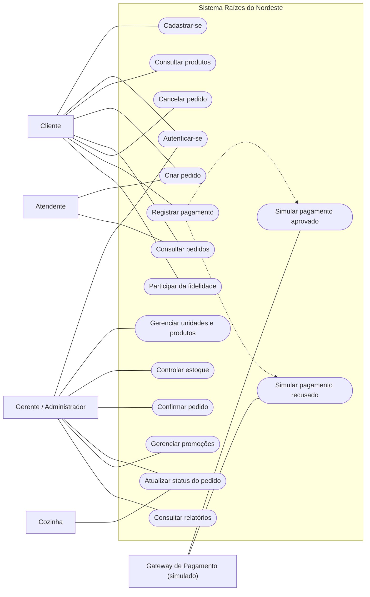

# Diagrama de Casos de Uso — Raízes do Nordeste

## 1. Objetivo

Representar as principais funcionalidades da API Raízes do Nordeste, os atores envolvidos nos processos de negócio e suas interações com o sistema, incluindo a simulação de pagamentos aprovados e recusados.

O diagrama contempla os cinco atores previstos nos requisitos acadêmicos: Cliente, Atendente, Cozinha, Gerente/Administrador e Gateway de Pagamento.

## 2. Atores

**Cliente (App/Web/Totem):** usuário que pode consultar produtos, criar pedidos, acompanhar seus pedidos, solicitar cancelamentos permitidos, registrar pagamentos e participar do programa de fidelidade mediante consentimento.

**Atendente (Balcão):** papel operacional previsto para o atendimento presencial, incluindo o registro e a consulta de pedidos realizados no balcão. Na implementação atual, não existe um perfil de autenticação ATENDENTE separado.

**Cozinha:** papel operacional responsável pelo acompanhamento e pela preparação dos pedidos. No modelo de negócio, participa da atualização dos estados de preparação. Na implementação atual, não existe um perfil de autenticação COZINHA separado; a atualização de status é controlada pelas permissões disponíveis na API.

**Gerente/Administrador:** usuário com privilégios administrativos para gerenciar unidades, produtos, estoque, pedidos e promoções, além de consultar relatórios. Na implementação atual, essas permissões são representadas pelo perfil ADMIN.

**Gateway de Pagamento (simulado):** ator externo conceitual que representa o processamento de pagamentos. Na implementação atual, a simulação ocorre internamente na API, sem comunicação com uma instituição financeira ou serviço bancário real.

## 3. Diagrama de casos de uso

**Nota:** as associações de Atendente e Cozinha representam responsabilidades do modelo de negócio. Elas não indicam a existência de endpoints ou perfis de autenticação exclusivos para esses atores.

## 4. Descrição dos principais casos de uso

| Código | Caso de uso | Ator principal | Resultado esperado |
|---|---|---|---|
| UC01 | Cadastrar-se | Cliente | Usuário cadastrado com perfil CLIENTE. |
| UC02 | Autenticar-se | Cliente ou Administrador | Token JWT gerado após validação das credenciais. |
| UC03 | Consultar produtos | Cliente | Produtos disponíveis para consulta. |
| UC04 | Criar pedido | Cliente; Atendente como papel previsto | Pedido registrado no banco de dados com um canal válido. |
| UC05 | Consultar pedidos | Cliente; Atendente como papel previsto | Consulta dos pedidos conforme as permissões disponíveis. |
| UC06 | Cancelar pedido | Cliente ou Administrador autorizado | Pedido cancelado quando permitido pelas regras de negócio. |
| UC07 | Registrar pagamento | Cliente ou Administrador autorizado | Pagamento simulado registrado para um pedido confirmado. |
| UC08 | Participar da fidelidade | Cliente | Participação condicionada ao consentimento do usuário. |
| UC09 | Gerenciar unidades e produtos | Administrador | Cadastro e consulta de unidades e produtos. |
| UC10 | Controlar estoque | Administrador | Controle das quantidades de produtos por unidade. |
| UC11 | Confirmar pedido | Administrador autorizado | Pedido confirmado após validação das regras de negócio e de estoque. |
| UC12 | Atualizar status do pedido | Administrador; Cozinha como papel previsto | Pedido avança conforme as transições de status permitidas. |
| UC13 | Gerenciar promoções | Administrador | Administração de regras promocionais. |
| UC14 | Consultar relatórios | Administrador | Acesso a informações gerenciais. |
| UC15 | Simular pagamento aprovado | Gateway de Pagamento simulado | Pagamento registrado com status APROVADO. |
| UC16 | Simular pagamento recusado | Gateway de Pagamento simulado | Pagamento registrado com status RECUSADO. |

## 5. Fluxos principais e alternativos

### 5.1. Criar e confirmar pedido

**Pré-condições:** usuário autenticado, unidade existente e produto cadastrado.

**Fluxo principal:**

1. O usuário informa a unidade, o canal do pedido e os produtos desejados.
2. A API valida os dados enviados.
3. O sistema registra o pedido com status CRIADO.
4. Um usuário autorizado solicita a confirmação do pedido.
5. O sistema verifica as regras de negócio e a disponibilidade de estoque.
6. Se as condições forem atendidas, o pedido passa para CONFIRMADO.

**Fluxos alternativos e exceções:**

- Dados inválidos impedem a criação do pedido.
- Produto ou unidade inexistente provoca uma resposta de erro.
- Estoque insuficiente impede a confirmação.
- Transições incompatíveis com o estado atual do pedido são rejeitadas.

### 5.2. Registrar pagamento

**Pré-condições:** pedido existente e confirmado, usuário autorizado e ausência de pagamento anteriormente registrado para o mesmo pedido.

**Fluxo principal — pagamento aprovado:**

1. O usuário solicita o pagamento de um pedido confirmado.
2. A API valida o pedido e o método de pagamento.
3. O serviço interno de simulação determina o resultado.
4. O pagamento é registrado com status APROVADO.
5. A operação é registrada na auditoria.

**Fluxo alternativo — pagamento recusado:**

1. O usuário solicita o pagamento de um pedido confirmado.
2. A API valida a solicitação.
3. A simulação retorna o status RECUSADO.
4. O pagamento recusado é registrado no banco de dados.
5. O pedido permanece com status CONFIRMADO.
6. A operação é registrada na auditoria.

**Regra utilizada na simulação acadêmica:** o método CARTAO_DEBITO produz o resultado RECUSADO. Os métodos PIX, CARTAO_CREDITO e DINHEIRO produzem o resultado APROVADO.

Essa regra é determinística e foi criada para permitir testes dos dois resultados. Não representa o comportamento de um gateway financeiro real.

**Exceção:** a implementação atual não permite registrar um segundo pagamento para o mesmo pedido, inclusive quando o primeiro foi recusado. Uma tentativa duplicada retorna erro de conflito.

### 5.3. Atualizar status do pedido

**Pré-condições:** pedido existente e usuário com permissão para a operação.

**Fluxo principal:**

1. O usuário autorizado solicita o avanço do pedido.
2. A API verifica o status atual.
3. O sistema verifica as condições exigidas para o avanço, incluindo o pagamento aprovado quando aplicável.
4. O pedido avança para o próximo estado permitido.

**Fluxos alternativos e exceções:**

- Pedido inexistente gera erro.
- Transição não permitida é rejeitada.
- A ausência de pagamento aprovado impede o avanço quando essa condição é exigida.

## 6. Regras relacionadas

- O cadastro público cria usuários com perfil CLIENTE.
- Operações administrativas exigem autenticação e autorização.
- A criação e a confirmação de pedidos seguem regras de estoque e status.
- O cancelamento depende do estado do pedido e das regras de negócio.
- O registro de pagamento exige um pedido confirmado.
- A simulação contempla os resultados APROVADO e RECUSADO.
- O sistema impede pagamentos duplicados para um mesmo pedido na implementação atual.
- A participação na fidelidade depende do consentimento do usuário.
- Os canais permitidos para pedidos são APP, TOTEM, BALCAO, PICKUP e WEB.
- Os papéis Atendente e Cozinha fazem parte do modelo de negócio, mas não possuem perfis JWT próprios na implementação atual.
- O gateway de pagamento é simulado internamente, sem integração financeira externa.

## 7. Observações sobre a implementação

O diagrama utiliza a sintaxe Mermaid para representar visualmente os casos de uso e seus atores. Trata-se de uma representação funcional, e não de um diagrama UML estrito.

Os cinco atores foram incluídos para atender à modelagem solicitada no projeto acadêmico. Entretanto, a implementação da API utiliza os perfis de autenticação CLIENTE e ADMIN. Portanto, os atores Atendente e Cozinha representam responsabilidades operacionais previstas, não perfis adicionais implementados.

O Gateway de Pagamento é um ator conceitual. O processamento de pagamentos é simulado internamente pela API.

O diagrama deve ser renderizado em formato visual e incluído no relatório final em PDF, juntamente com os diagramas de classes e entidade-relacionamento.

## 8. Fonte

Elaborado pelo autor a partir dos requisitos e das funcionalidades desenvolvidas para o projeto acadêmico Raízes do Nordeste — UNINTER, 2026.
