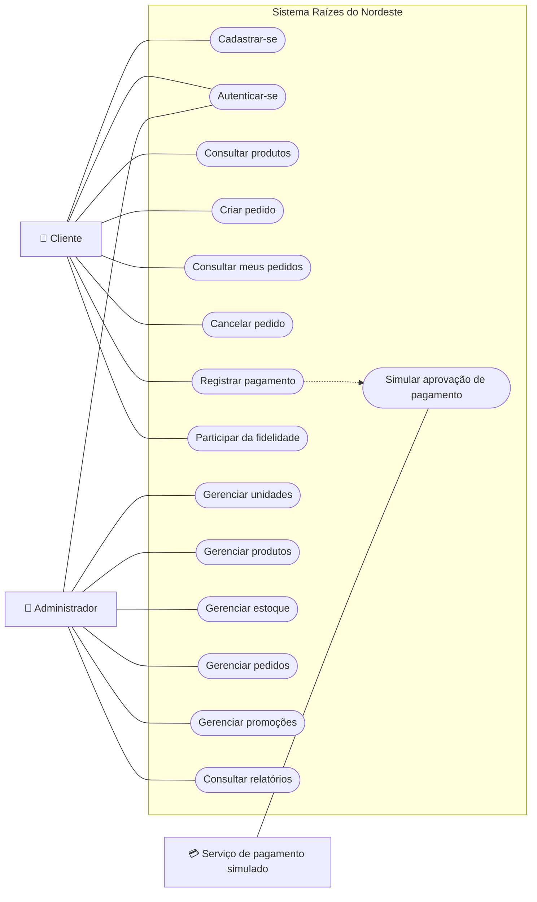

# Diagrama de Casos de Uso — Raízes do Nordeste

## 1. Objetivo

Representar as principais funcionalidades da API Raízes do Nordeste e sua interação com os usuários e o serviço de pagamento simulado.

## 2. Atores

**Cliente:** usuário cadastrado que pode consultar produtos, criar pedidos, acompanhar seus pedidos, solicitar cancelamentos permitidos e registrar pagamentos.

**Administrador:** usuário com privilégios para gerenciar unidades, produtos, estoque, pedidos, promoções e consultar informações administrativas.

**Serviço de pagamento simulado:** componente conceitual que representa a resposta de uma integração externa de pagamento. Na implementação atual, a simulação é realizada internamente pela API.

## 3. Diagrama de casos de uso

## 4. Descrição dos principais casos de uso

| Código | Caso de uso | Ator principal | Resultado esperado |
|---|---|---|---|
| UC01 | Cadastrar-se | Cliente | Usuário cadastrado com perfil CLIENTE. |
| UC02 | Autenticar-se | Cliente ou Administrador | Token JWT gerado após validação das credenciais. |
| UC03 | Consultar produtos | Cliente | Produtos disponíveis para consulta. |
| UC04 | Criar pedido | Cliente | Pedido registrado no banco de dados. |
| UC05 | Consultar meus pedidos | Cliente | Listagem dos pedidos associados ao usuário. |
| UC06 | Cancelar pedido | Cliente ou Administrador autorizado | Pedido cancelado quando permitido pelas regras de negócio. |
| UC07 | Registrar pagamento | Cliente ou Administrador autorizado | Pagamento simulado registrado para um pedido confirmado. |
| UC08 | Participar da fidelidade | Cliente | Participação condicionada ao consentimento. |
| UC09 | Gerenciar unidades | Administrador | Cadastro e consulta de unidades. |
| UC10 | Gerenciar produtos | Administrador | Cadastro e consulta de produtos. |
| UC11 | Gerenciar estoque | Administrador | Controle das quantidades de produtos por unidade. |
| UC12 | Gerenciar pedidos | Administrador | Consulta, confirmação e atualização de status dos pedidos. |
| UC13 | Gerenciar promoções | Administrador | Administração de regras promocionais. |
| UC14 | Consultar relatórios | Administrador | Acesso a informações gerenciais. |
| UC15 | Simular aprovação de pagamento | Serviço de pagamento simulado | Resultado de aprovação registrado pela API. |

## 5. Regras relacionadas

- O cadastro público cria usuários com perfil CLIENTE.
- Operações administrativas exigem autorização.
- A criação e a confirmação de pedidos seguem regras de estoque e status.
- O cancelamento depende do status do pedido e das regras de pagamento.
- O registro de pagamento exige um pedido confirmado.
- A participação na fidelidade depende do consentimento do usuário.
- Os canais permitidos para pedidos são APP, TOTEM, BALCAO, PICKUP e WEB.

## 6. Observações

O diagrama utiliza a sintaxe Mermaid para representar visualmente os casos de uso e seus atores. Trata-se de uma representação funcional, não de um diagrama UML estrito.

A simulação de pagamento está representada como um ator conceitual para evidenciar a integração prevista nos requisitos, embora o comportamento atual seja implementado internamente.

O diagrama deverá ser renderizado e incluído no relatório final em PDF para permitir a visualização pelo professor avaliador.

## 7. Fonte

Elaborado a partir das funcionalidades e regras de negócio do projeto Raízes do Nordeste.