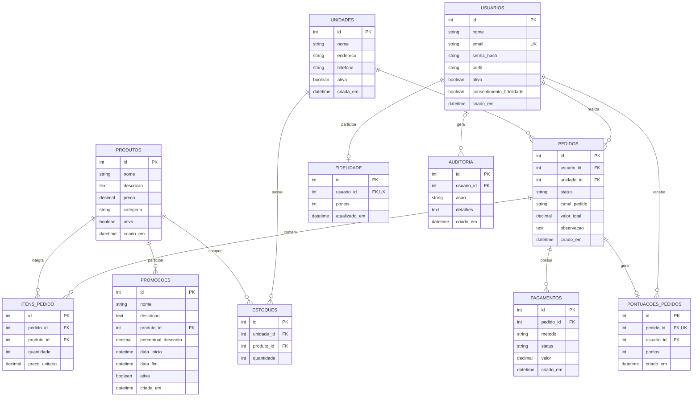

# DER — Diagrama Entidade-Relacionamento

## Projeto Raízes do Nordeste

Este diagrama representa as 11 entidades definidas no arquivo `app/models.py`, incluindo as chaves primárias (PK), as chaves estrangeiras (FK) e os relacionamentos.

## Legenda

- **PK:** chave primária.
- **FK:** chave estrangeira.
- **UK:** restrição de unicidade.
- **1:N:** um registro pode estar associado a vários registros.
- **1:0..1:** um registro pode estar associado a zero ou um registro.
- **0..1:N:** relacionamento com participação opcional de um dos lados.

## Observações sobre o modelo

1. Um usuário pode realizar vários pedidos.
2. Uma unidade pode receber vários pedidos e possuir vários registros de estoque.
3. Um produto pode aparecer em diferentes registros de estoque e itens de pedidos.
4. Um pedido pode conter vários itens.
5. O campo `usuario_id` em `auditoria` é opcional.
6. O campo `usuario_id` em `fidelidade` possui restrição de unicidade.
7. O campo `pedido_id` em `pontuacoes_pedidos` possui restrição de unicidade.
8. O relacionamento entre pedido e pagamento está configurado como um para um no ORM (`uselist=False`), mas o campo `pagamentos.pedido_id` não possui restrição `unique=True` no modelo apresentado. Portanto, essa cardinalidade ainda não é garantida pelo banco de dados.

## Fonte

Diagrama elaborado a partir do código-fonte `app/models.py` do projeto Raízes do Nordeste.