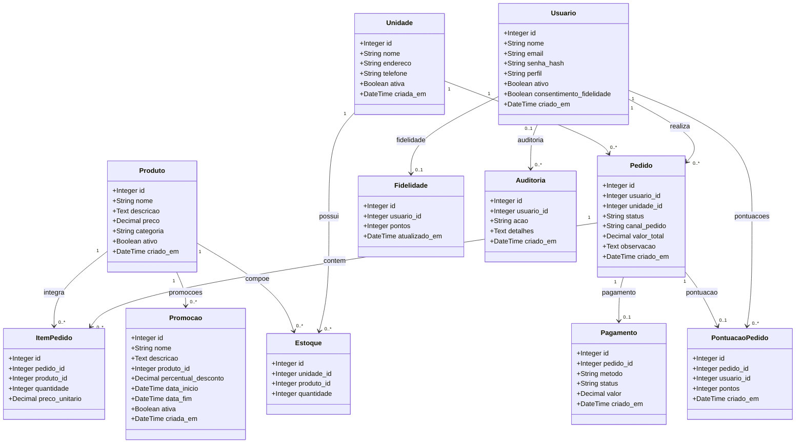

# Diagrama de Classes — Raízes do Nordeste

## 1. Apresentação

Este diagrama representa as principais classes de persistência do sistema Raízes do Nordeste, conforme definidas no arquivo `app/models.py`.

As classes correspondem às entidades gerenciadas pelo SQLAlchemy.

## 2. Diagrama de classes

## 3. Descrição das classes

| Classe | Responsabilidade |
|---|---|
| Usuario | Armazenar os dados dos usuários e seus perfis de acesso. |
| Unidade | Representar as unidades da rede de lanchonetes. |
| Produto | Armazenar os produtos do cardápio. |
| Estoque | Controlar a quantidade de cada produto em uma unidade. |
| Pedido | Registrar os pedidos realizados pelos usuários. |
| ItemPedido | Representar os produtos e quantidades de um pedido. |
| Pagamento | Registrar os pagamentos associados aos pedidos. |
| Fidelidade | Armazenar os pontos de fidelidade do usuário. |
| Auditoria | Registrar eventos relevantes para rastreabilidade. |
| PontuacaoPedido | Registrar os pontos atribuídos a um pedido. |
| Promocao | Armazenar regras de desconto vinculadas a produtos. |

## 4. Observações

- As classes representam o modelo de persistência, não todas as funções da aplicação.
- Os relacionamentos foram identificados a partir das chaves estrangeiras e das declarações `relationship` existentes no código.
- A relação entre Pedido e Pagamento é representada como um para zero ou um na aplicação, mas a unicidade não está garantida por uma restrição explícita no banco de dados.
- O diagrama será convertido em formato visual e incluído no relatório final em PDF.

## 5. Fonte

Diagrama elaborado a partir do arquivo `app/models.py` do projeto Raízes do Nordeste.